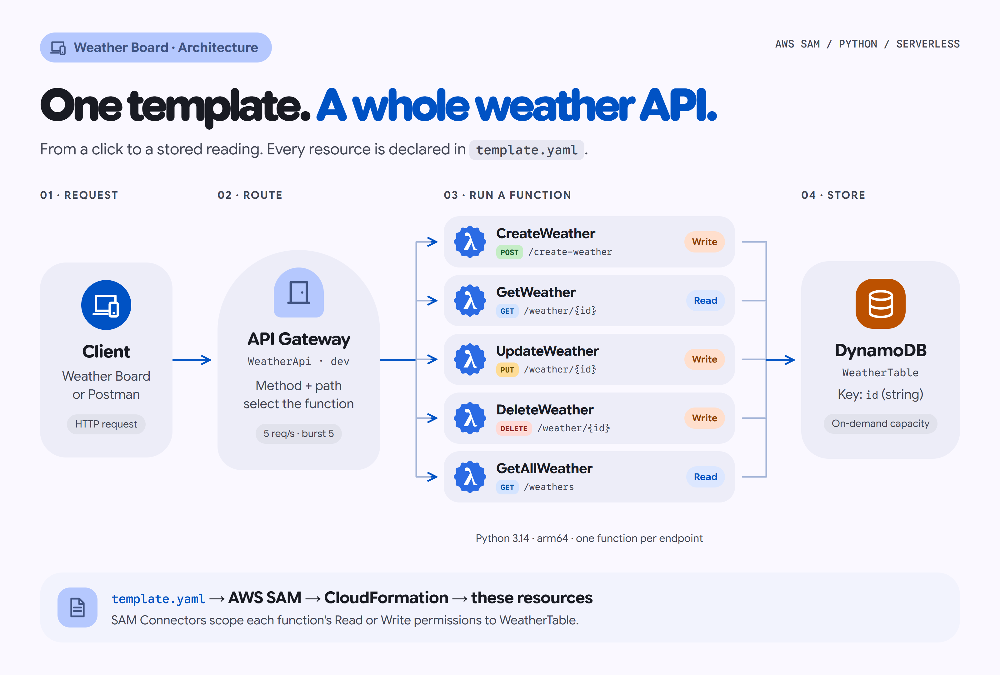

# rest-weather-api

A serverless **CRUDL REST API** built with **AWS SAM**, **Amazon API Gateway**, **AWS Lambda (Python)** and **Amazon DynamoDB**, from the Educloud Academy course *Building a Serverless Rest Api With AWS SAM and Python*. It comes with a web dashboard, a Postman collection, unit tests and a local mode that needs no AWS account.



[Editable architecture diagram](docs/architecture.html)

```
Client ──HTTP──▶ API Gateway (WeatherApi, stage "dev")
                    ├─ POST   /create-weather  ─▶ CreateWeatherLambda  ──Write──▶ ┐
                    ├─ GET    /weather/{id}    ─▶ GetWeatherLambda     ──Read───▶ │
                    ├─ PUT    /weather/{id}    ─▶ UpdateWeatherLambda  ──Write──▶ ├─ DynamoDB: WeatherTable
                    ├─ DELETE /weather/{id}    ─▶ DeleteWeatherLambda  ──Write──▶ │
                    └─ GET    /weathers        ─▶ GetAllWeatherLambda  ──Read───▶ ┘
```

The **whole backend** (API, five functions, the table and every permission between them) is declared in one file: [`template.yaml`](template.yaml).

---

## What's in here

| Path | What it is |
| --- | --- |
| `template.yaml` | The SAM template: Globals, the API, the table, five functions and their **Connectors** (permissions) |
| `src/` | One small Python handler per endpoint, plus `api_response.py` (shared response + validation helpers) |
| `web/index.html` | **Weather Board** dashboard in Material 3 Expressive. Open it in a browser: *Demo* mode works offline, *Live API* talks to your deployment and shows which Lambda each click hits. Design research and decisions: [`docs/DESIGN.md`](docs/DESIGN.md) |
| `web/palettes.js` | M3 colour schemes (light + dark) for each weather condition, generated with Google's `material-color-utilities` |
| `postman/` | Postman collection: the full CRUDL flow plus 404/400 checks, with tests |
| `scripts/smoke_test.py` | Runs the full CRUDL cycle against any deployed URL and prints PASS/FAIL per request |
| `scripts/local_api.py` | Runs the real handlers on `http://localhost:3000/dev` with an in-memory DynamoDB (no AWS, no Docker) |
| `events/` | Sample API Gateway events for `sam local invoke` |
| `tests/` | 19 unit tests (pytest + moto) |

---

## The endpoints

| Operation | Request | Body | Success | Errors |
| --- | --- | --- | --- | --- |
| Create | `POST /create-weather` | `{"weather": "Cold", "town": "Douala"}` | `201` + the new item | `400` invalid body |
| Read | `GET /weather/{id}` | none | `200` + the item | `404` not found |
| Update | `PUT /weather/{id}` | `{"weather": "HOT", "town": "Douala"}` | `200` + the updated item | `400`, `404` |
| Delete | `DELETE /weather/{id}` | none | `200` + the deleted item | `404` |
| List | `GET /weathers` | none | `200` + array, newest first | |

An item looks like:
```json
{
  "id": "3f0c2a8e-6b1d-4c55-9a43-1d2e7a9b0c11",
  "weather": "Rainy",
  "town": "Buea",
  "createdAt": "2026-10-27T08:30:00+00:00",
  "updatedAt": "2026-10-27T08:30:00+00:00"
}
```

---

## Run it without AWS (2 minutes)

You need [uv](https://docs.astral.sh/uv/) (it installs the right Python for you).

```powershell
uv sync                                  # install test/dev tools into .venv
uv run pytest                            # 19 tests against a mocked DynamoDB
uv run python scripts/local_api.py       # API on http://localhost:3000/dev
```

Then open `web/index.html`, switch to **Live API** and paste `http://localhost:3000/dev`. In a second terminal you can also run:

```powershell
uv run python scripts/smoke_test.py http://localhost:3000/dev
```

---

## Deploy to AWS

**Prerequisites:** an AWS account with an IAM user (not root), the [AWS CLI](https://docs.aws.amazon.com/cli/latest/userguide/getting-started-install.html) configured with `aws configure`, and the [AWS SAM CLI](https://docs.aws.amazon.com/serverless-application-model/latest/developerguide/install-sam-cli.html).

```powershell
sam validate --lint
sam build
sam deploy --guided
```

Answers for the guided prompts:

| Prompt | Answer |
| --- | --- |
| Stack Name | `rest-weather-api` (hyphens, **never underscores**) |
| AWS Region | your region, e.g. `us-east-2` or `eu-west-1` |
| Confirm changes before deploy | `y` |
| Allow SAM CLI IAM role creation | `Y` (SAM creates the least-privilege roles from the Connectors) |
| *Function* may not have authorization defined, is this okay? | `y` for each (this is a public learning API) |
| Save arguments to configuration file | `Y` (next time, just `sam deploy`) |

Copy **`WeatherApiUrl`** from the Outputs, then test it any of three ways:

1. **Postman:** import `postman/rest-weather-api.postman_collection.json`, set the `baseUrl` variable (no trailing slash), run the collection.
2. **Smoke test:** `uv run python scripts/smoke_test.py <WeatherApiUrl>`
3. **Dashboard:** open `web/index.html` → *Live API* → paste the URL.

### Throttling
The API has no login, so the `dev` stage is capped at **5 requests/second with a burst of 5** (`MethodSettings` on `WeatherApi`). Requests over the limit get `429 Too Many Requests` and never reach Lambda. This caps how much a sustained flood can cost.

Two things I learned testing this on the live API:
- **API Gateway throttling is best-effort.** It reliably limits *sustained* traffic, but a sharp burst (40 requests in 2 seconds) still let most requests through before the limit kicked in.
- **New AWS accounts can run only 10 Lambda functions at the same time**, across the whole region and shared by every app in the account. Requests beyond that are rejected by Lambda, and API Gateway reports them as `500` errors. A big burst here can briefly throttle your *other* apps too.

The fix for the second one is free: in the AWS console, open **Service Quotas → AWS Lambda → Concurrent executions** and request an increase (e.g. to 1000). Check your current limit with `aws lambda get-account-settings`.

### Clean up when you're done
```powershell
sam delete --stack-name rest-weather-api
```
This removes everything the template created, including the table and its data.

**Cost:** with on-demand DynamoDB and Lambda, a learning project like this sits comfortably inside the AWS Free Tier. There's nothing running when nobody calls the API.

---

## How a request flows (the bit that made it click for me)

1. Postman sends `PUT /weather/abc-123` with a JSON body.
2. **API Gateway** matches the method + path to `UpdateWeatherLambda` and wraps the HTTP request into an `event`: the body becomes a JSON *string* in `event['body']`, and `abc-123` lands in `event['pathParameters']['id']`.
3. **Lambda** runs `update_weather.lambda_handler(event, context)`. The `TABLE_NAME` environment variable comes from `Globals` in the template (`!Ref WeatherTable`).
4. The handler calls **DynamoDB** `update_item`. It's allowed to because the template's **Connector** gave this function *Write* access to *this table only*.
5. The handler returns `{'statusCode': 200, 'headers': ..., 'body': '...'}` and API Gateway turns that back into an HTTP response.

---

## Hardening: what I changed from the course version and why

The course keeps the handlers minimal so beginners can follow every line. When I made the project my own, I deliberately tried to break it. These are the edge cases I fixed, and each one has a test in `tests/test_handlers.py`:

| # | Edge case | Cause | Fix |
| --- | --- | --- | --- |
| 1 | Two items silently overwrite each other | IDs were `random.randrange(100, 999)`: only 899 values. By the **birthday paradox** there's a **~50% chance of a collision after just 36 items**, and `put_item` overwrites without complaint | `uuid4()` IDs + `ConditionExpression="attribute_not_exists(id)"` |
| 2 | `GET` on a missing id → 502 | `response['Item']` raises `KeyError` when nothing matches | Check for `Item`, return **404** |
| 3 | The error handler itself crashes | `except table_name:` catches a *string*; Python raises `TypeError` the moment an error happens | `except ClientError` |
| 4 | `PUT` on a missing id creates a new item | `update_item` is an upsert by default | `ConditionExpression="attribute_exists(id)"` → **404** |
| 5 | `DELETE` on a missing id says "deleted successfully" | `delete_item` doesn't fail for missing keys | Condition + `ReturnValues="ALL_OLD"` → **404** |
| 6 | Missing/invalid body → crash | `json.loads(None)`, missing keys | Validate in `api_response.parse_weather_body` → **400** with a clear message |
| 7 | `GET /weathers` silently stops at 1 MB | `scan` returns pages | Loop on `LastEvaluatedKey` |
| 8 | A browser front-end can't call the API | No CORS | `Globals.Api.Cors` + CORS headers on every response |

Other small upgrades: `python3.14` on **arm64** (Graviton, cheaper per ms), **on-demand** DynamoDB billing (no capacity to tune, free-tier friendly), `201 Created` for creates, `createdAt`/`updatedAt` timestamps, and `Description` moved inside `Properties` so SAM actually keeps it (flagged by `cfn-lint`).

What I **kept** from the course on purpose: the same routes, the same file names, one handler per endpoint, SAM Connectors for permissions and `print` for logging. The point is still to learn the basics.

---

## Ideas for next steps
- Add an API key or Cognito authorizer so the API isn't public.
- Use Lambda Powertools for structured logging and tracing.
- Add a GitHub Actions workflow that runs `pytest` and `sam deploy` on push.
- Store a temperature number (and learn why DynamoDB returns it as `Decimal`).
