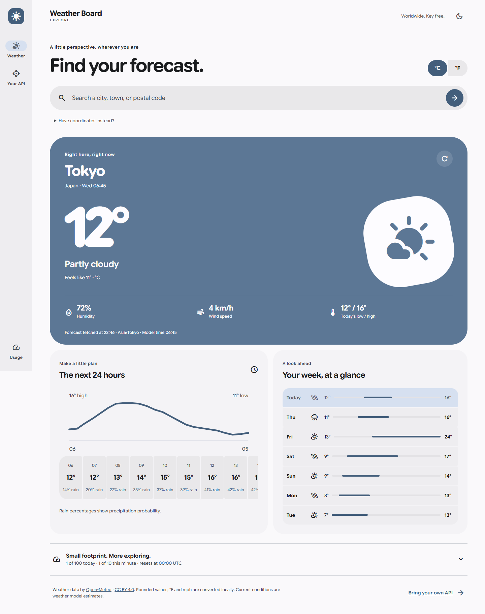
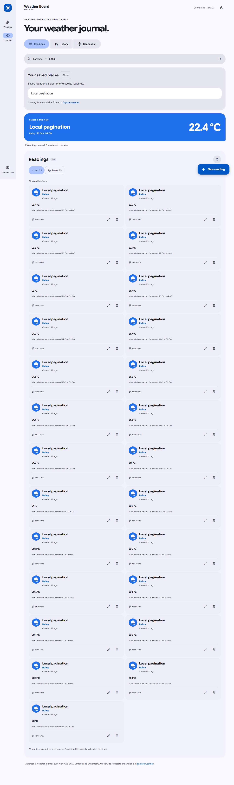

# rest-weather-api

A serverless **CRUDL REST API** built with **AWS SAM**, **Amazon API Gateway**, **AWS Lambda (Python)** and **Amazon DynamoDB**, from the Educloud Academy course *Building a Serverless Rest Api With AWS SAM and Python*. It comes with a web dashboard, a Postman collection, unit tests and a local mode that needs no AWS account.


[Editable architecture diagram](docs/architecture.html)

```
Client ──HTTP──▶ API Gateway (WeatherApi, stage "dev")
                    ├─ POST   /create-weather  ─▶ CreateWeatherLambda  ──Write──▶ ┐
                    ├─ GET    /weather/{id}    ─▶ GetWeatherLambda     ──Read───▶ │
                    ├─ PUT    /weather/{id}    ─▶ UpdateWeatherLambda  ──Write──▶ ├─ DynamoDB: WeatherTable
                    ├─ DELETE /weather/{id}    ─▶ DeleteWeatherLambda  ──Write──▶ │
                    ├─ GET    /weathers        ─▶ GetAllWeatherLambda  ──Read───▶ │
                    └─ GET    /locations       ─▶ GetAllWeatherLambda  ──Read───▶ ┘
```

The **whole backend** (API, five functions, the table and every permission between them) is declared in one file: [`template.yaml`](template.yaml).

---

## What's in here

| Path | What it is |
| --- | --- |
| `template.yaml` | The SAM template: Globals, the API, the table, five functions and their **Connectors** (permissions) |
| `src/` | One small Python handler per endpoint, plus `api_response.py` (shared response + validation helpers) |
| `web/index.html` | **Explore weather**: worldwide Open-Meteo forecasts, no key or billing setup. Material 3 Expressive design. Research and decisions: [`docs/DESIGN.md`](docs/DESIGN.md) |
| `web/workspace.html` | **Your API**: explicitly connect your own compatible Weather Board deployment for saved readings, location search, history, and request inspection |
| `web/request-policy.js` | Persistent browser request allowances, bounded cache, duplicate suppression, timeouts, and provider cooldowns |
| `web/palettes.js` | M3 colour schemes (light + dark) for each weather condition, generated with Google's `material-color-utilities` |
| `postman/` | Postman collection: the full CRUDL flow plus 404/400 checks, with tests |
| `scripts/smoke_test.py` | Runs the full CRUDL cycle against any deployed URL and prints PASS/FAIL per request |
| `scripts/local_api.py` | Runs the real handlers on `http://localhost:3000/dev` with an in-memory DynamoDB (no AWS, no Docker) |
| `events/` | Sample API Gateway events for `sam local invoke` |
| `tests/` | 54 Python tests (pytest + moto) and 11 dependency-free JavaScript tests |

---

## The endpoints

| Operation | Request | Body | Success | Errors |
| --- | --- | --- | --- | --- |
| Create | `POST /create-weather` | `{"weather": "Cold", "town": "Douala"}` | `201` + the new item | `400` invalid body |
| Read | `GET /weather/{id}` | none | `200` + the item | `404` not found |
| Update | `PUT /weather/{id}` | `{"weather": "HOT", "town": "Douala"}` | `200` + the updated item | `400`, `404` |
| Delete | `DELETE /weather/{id}` | none | `200` + the deleted item | `404` |
| List / history | `GET /weathers?town=Buea&limit=20` | none | `200` + `{items, nextCursor}` | `400` invalid query |
| Find saved locations | `GET /locations?q=bu&limit=10` | none | `200` + `{items: [{town}], nextCursor}` | `400` invalid query |

An item looks like:
```json
{
  "id": "3f0c2a8e-6b1d-4c55-9a43-1d2e7a9b0c11",
  "weather": "Rainy",
  "town": "Buea",
  "createdAt": "2026-10-27T08:30:00+00:00",
  "updatedAt": "2026-10-27T08:30:00+00:00"
}
```


### Optional observation details

Existing `{ "weather": "Rainy", "town": "Buea" }` requests still work. You can also send:

```json
{
  "weather": "Rainy",
  "town": "Buea",
  "temperatureC": 21.5,
  "humidityPct": 87,
  "windKph": 12,
  "observedAt": "2026-11-03T09:15:00+01:00",
  "latitude": 4.156,
  "longitude": 9.232,
  "source": "manual"
}
```

| Field | Validation |
| --- | --- |
| `temperatureC` | JSON number, -100 to 70 °C |
| `humidityPct` | JSON number, 0 to 100% |
| `windKph` | JSON number, 0 to 500 km/h |
| `latitude`, `longitude` | Supply together; -90 to 90 and -180 to 180 |
| `observedAt` | ISO 8601 date/time with a timezone; normalized to UTC |
| `source` | `manual` (default for new readings) or `imported` |
| `provider` | Required with `source: "imported"`; a non-empty name up to 60 characters |

On PUT, omitted details are preserved; explicit `null` removes an optional detail. Clear coordinates together. Changing the source to `manual` removes the provider. Numbers stay JSON numbers throughout DynamoDB storage and API responses. Old readings without measurements remain valid, with unknown values left blank.

The **Your API** workspace shows measurements, observation time, coordinates, and provenance in condition themes. Its form records manual observations; editing an imported record marks it manual. Imported provenance is caller-supplied metadata, not verification of a provider. **Explore weather** fetches actual model forecasts separately; browsing forecasts never writes readings to your API.


---

## Location history and charts

Connect **Your API**, then open **History** or click a location name on a reading card. Select a town, temperature/humidity/wind, and an optional inclusive local date range. **All dates** resets the range. Switch between °C/km/h and °F/mph; this display preference is saved locally and also applies to the hero and cards. API payloads and the reading form continue to use Celsius and km/h.

Charts use actual observation timestamps, falling back to creation time for legacy readings. Missing measurements break the line, unknown timestamps are not plotted, and a single reading is shown as one point. The scrollable table provides exact values, source labels, and observed/recorded time. Dates without a supplied timestamp remain unknown. Readings are grouped by normalized town name, so use distinct town labels for places sharing a name.

History now queries its own town/date pages, independently from the main readings feed. **Load older readings** extends the table and chart. Counts and chart ranges cover only loaded pages, not the whole archive. The view shows currently saved readings, not previous versions of edited or deleted records. History contains only your own saved readings. It is separate from the worldwide forecast view.


The chart helpers have dependency-free tests, runnable with Node.js:

```powershell
node --test tests/history.test.cjs tests/request-policy.test.cjs
```

---

## Search locations and load pages

The search box defaults to **Location**. Enter a town prefix (for example `bu` for Buea), submit, and choose a saved location to query its readings. Choose **Reading ID** for direct lookup. **All locations** clears the current town filter. The feed loads 20 readings at a time; **Load more readings** requests the next page. Condition filters and summary counts describe loaded readings only.

Worldwide search lives in **Explore weather**. Enter a city, town, or postal code, then choose a match from the list of regions/countries. You can also enter coordinates, including locations outside named settlements. Distinct saved places in **Your API** should retain distinct town labels (such as `Paris, Île-de-France, France`).

## Explore weather and request controls

**Explore weather** replaces the former synthetic Demo. It uses Open-Meteo’s free non-commercial geocoding and forecast endpoints directly from the browser, with no API key, signup, billing account, Google project, or AWS calls. Current model estimates, a 24-hour temperature/rain-probability view, and seven daily forecasts are shown in the selected place’s timezone. Search returns up to eight matches. °F and mph are converted locally. Data attribution and conversion notes are displayed in the app.

The free hosted service is for non-commercial use; commercial use requires an appropriate provider plan. See [Open-Meteo’s terms](https://open-meteo.com/en/terms), [forecast documentation](https://open-meteo.com/en/docs), and [geocoding documentation](https://open-meteo.com/en/docs/geocoding-api). The Google Weather fallback is unnecessary; no paid Google API has been enabled. Licensed fonts and the icon subset are served locally, so the interface does not depend on a font CDN.

| Control | Behavior |
| --- | --- |
| Explicit requests | No startup weather fetch, background polling, typeahead requests, or automatic retries. Submit a search, select a place, or press Refresh. |
| Persistent allowance | At most 10 fetch attempts/minute and 100/UTC day per browser origin. Searches and forecasts share the weather allowance; Your API has a separate allowance, shared across its base URLs. Failed network/provider attempts count. |
| Cross-tab coordination | Web Locks serialize allowance reservations where supported. A localStorage counter survives reloads; unavailable or corrupt budget storage blocks new requests. These are browser controls, not tamper-resistant quotas. |
| Cache | Forecast responses last 15 minutes; geocoding responses 24 hours. At most 30 cache entries. Cache hits and duplicate simultaneous GETs do not consume more requests. Refresh honors the cache. |
| Bounded payload | One location, seven days, ten requested weather variables. Requests time out after ten seconds. Provider 429 responses establish a persistent cooldown of at least one minute, respecting Retry-After up to 24 hours. |
| Explicit connection | A saved URL only prefills the Your API form. Connect is required after every page load. Editing it disconnects. HTTPS is required except loopback; URL credentials/query strings/fragments are rejected. Cookies and HTTP redirects are omitted. |
| Disconnect | Stops new API requests, aborts pending requests, clears displayed readings, and closes the reading editor. Aborting cannot undo a request already processed by the server. |

**Limits:** clearing storage, using another browser/origin, unsupported cross-tab locking, or editing the code can bypass client controls. Browser fetch counters exclude automatic CORS preflights. They cannot enforce a shared visitor quota or a hard spending cap on your provider account. Open-Meteo's free endpoint has no billing setup to charge; the BYO API may incur its provider's charges. Protect a public deployment with authentication and provider-side quotas/billing controls before broader use. The existing AWS throttle is retained, with its limitations described below. The default Explore view never accesses that deployment.



### Paginated API contract


`GET /weathers` now returns an object, replacing the old unbounded array:

```json
{"items": [], "nextCursor": null}
```

- `limit`: integer 1 to 100, default 20.
- `town`: optional exact normalized town name; case and repeated whitespace are ignored.
- `from`, `to`: optional ISO 8601 timestamps with timezones; lower bound inclusive, upper bound exclusive. Sorted newest observation first, with creation time used when observation time is absent. Very old rows without either timestamp sort at the epoch but keep their original unknown time in the response.
- `cursor`: opaque continuation from the previous response. Keep the same town/date filters. A cursor from another query is rejected with 400. Pagination is not a snapshot; concurrent writes and eventually consistent indexes may affect later pages.
- `GET /locations?q=prefix` returns distinct known location names with the same `limit`/`cursor` mechanism, in name order. Catalog names may remain after their last reading is removed or renamed, so a selected town may have no current readings.

Readings use `FeedIndex` for the global feed and `TownIndex` for location/date queries. Catalog entries reuse a separate partition in `FeedIndex`. Runtime list/search endpoints perform one bounded Query each, never a table scan. The single feed partition fits this small project; a high-volume service should shard it. Two indexes add storage/write costs under the existing on-demand billing model.

### Migrating an existing deployment

AWS permits adding one GSI per table update. Add `FeedIndex` first, then `TownIndex`, keeping the previous API code until both indexes are ACTIVE. Use staged SAM templates outside the repository for that bootstrap; new deployments can create both indexes together. Run the backfill with `--no-catalog` before switching the API, then run it normally after deploying the paginated API:

```powershell
uv run python scripts/backfill_search.py --table YOUR_TABLE --region us-east-1 --backup C:/private-backups/weather-before.jsonl --no-catalog
# Deploy the new API, then populate the location catalog:
uv run python scripts/backfill_search.py --table YOUR_TABLE --region us-east-1 --backup C:/private-backups/weather-after.jsonl
```

The migration uses bounded scan pages only for this one-time administrative operation, preserves business fields, writes a DynamoDB-typed JSON-lines backup before each change, skips concurrent edits, and can be rerun with a new backup filename. Keep backups outside the repository. Updates now use a revision guard; a concurrent change returns 409 instead of silently overwriting it.



---

## Run it without AWS (2 minutes)

You need [uv](https://docs.astral.sh/uv/) (it installs the right Python for you).

```powershell
uv sync                                  # install test/dev tools into .venv
uv run pytest                            # 54 tests against a mocked DynamoDB
uv run python scripts/local_api.py       # API on http://localhost:3000/dev
```

Serve the frontend from another terminal:

```powershell
uv run python -m http.server 8766 --bind 127.0.0.1 --directory web
```

Open [Weather Board](http://127.0.0.1:8766/). **Explore weather** needs internet access. To test saved readings, choose **Your API**, enter `http://localhost:3000/dev`, and press **Connect**. In a second terminal you can also run:

```powershell
uv run python scripts/smoke_test.py http://localhost:3000/dev
```

---

## Deploy to AWS

**Prerequisites:** an AWS account with an IAM user (not root), the [AWS CLI](https://docs.aws.amazon.com/cli/latest/userguide/getting-started-install.html) configured with `aws configure`, and the [AWS SAM CLI](https://docs.aws.amazon.com/serverless-application-model/latest/developerguide/install-sam-cli.html).

```powershell
sam validate --lint
sam build
sam deploy --guided
```

Answers for the guided prompts:

| Prompt | Answer |
| --- | --- |
| Stack Name | `rest-weather-api` (hyphens, **never underscores**) |
| AWS Region | your region, e.g. `us-east-2` or `eu-west-1` |
| Confirm changes before deploy | `y` |
| Allow SAM CLI IAM role creation | `Y` (SAM creates the least-privilege roles from the Connectors) |
| *Function* may not have authorization defined, is this okay? | `y` for each (this is a public learning API) |
| Save arguments to configuration file | `Y` (next time, just `sam deploy`) |

Copy **`WeatherApiUrl`** from the Outputs, then test it any of three ways:

1. **Postman:** import `postman/rest-weather-api.postman_collection.json`, set the `baseUrl` variable (no trailing slash), run the collection.
2. **Smoke test:** `uv run python scripts/smoke_test.py <WeatherApiUrl>`
3. **Dashboard:** serve `web/`, open **Your API**, paste the URL, and press **Connect**.

### Throttling
The API has no login. Its `dev` stage uses a **5 requests/second throttle with a burst of 5** (`MethodSettings` on `WeatherApi`). API Gateway may reject traffic with 429 before Lambda, but these are best-effort limits. They reduce sustained load; they do not cap total spending or prevent unauthorized use.

Two things I learned testing this on the live API:
- **API Gateway throttling is best-effort.** It reliably limits *sustained* traffic, but a sharp burst (40 requests in 2 seconds) still let most requests through before the limit kicked in.
- **New AWS accounts can run only 10 Lambda functions at the same time**, across the whole region and shared by every app in the account. Requests beyond that are rejected by Lambda, and API Gateway reports them as `500` errors. A big burst here can briefly throttle your *other* apps too.

The fix for the second one is free: in the AWS console, open **Service Quotas → AWS Lambda → Concurrent executions** and request an increase (e.g. to 1000). Check your current limit with `aws lambda get-account-settings`.

### Clean up when you're done
```powershell
sam delete --stack-name rest-weather-api
```
This removes everything the template created, including the table and its data.

**Cost:** AWS charges depend on usage, stored data, region, and account eligibility. DynamoDB tables and indexes can incur storage costs while idle. Neither the browser allowance nor the API Gateway throttle guarantees staying inside a free tier. Explore weather itself uses the key-free Open-Meteo endpoint and does not call AWS.

---

## How a request flows (the bit that made it click for me)

1. Postman sends `PUT /weather/abc-123` with a JSON body.
2. **API Gateway** matches the method + path to `UpdateWeatherLambda` and wraps the HTTP request into an `event`: the body becomes a JSON *string* in `event['body']`, and `abc-123` lands in `event['pathParameters']['id']`.
3. **Lambda** runs `update_weather.lambda_handler(event, context)`. The `TABLE_NAME` environment variable comes from `Globals` in the template (`!Ref WeatherTable`).
4. The handler calls **DynamoDB** `update_item`. It's allowed to because the template's **Connector** gave this function *Write* access to *this table only*.
5. The handler returns `{'statusCode': 200, 'headers': ..., 'body': '...'}` and API Gateway turns that back into an HTTP response.

---

## Hardening: what I changed from the course version and why

The course keeps the handlers minimal so beginners can follow every line. When I made the project my own, I deliberately tried to break it. These are the edge cases I fixed, and each one has a test in `tests/test_handlers.py`:

| # | Edge case | Cause | Fix |
| --- | --- | --- | --- |
| 1 | Two items silently overwrite each other | IDs were `random.randrange(100, 999)`: only 899 values. By the **birthday paradox** there's a **~50% chance of a collision after just 36 items**, and `put_item` overwrites without complaint | `uuid4()` IDs + `ConditionExpression="attribute_not_exists(id)"` |
| 2 | `GET` on a missing id → 502 | `response['Item']` raises `KeyError` when nothing matches | Check for `Item`, return **404** |
| 3 | The error handler itself crashes | `except table_name:` catches a *string*; Python raises `TypeError` the moment an error happens | `except ClientError` |
| 4 | `PUT` on a missing id creates a new item | `update_item` is an upsert by default | `ConditionExpression="attribute_exists(id)"` → **404** |
| 5 | `DELETE` on a missing id says "deleted successfully" | `delete_item` doesn't fail for missing keys | Condition + `ReturnValues="ALL_OLD"` → **404** |
| 6 | Missing/invalid body → crash | `json.loads(None)`, missing keys | Validate in `api_response.parse_weather_body` → **400** with a clear message |
| 7 | An unbounded list becomes expensive as data grows | A full-table scan reads the archive | Indexed, bounded Query pages with explicit continuation cursors |
| 8 | A browser front-end can't call the API | No CORS | `Globals.Api.Cors` + CORS headers on every response |

Other small upgrades: `python3.14` on **arm64** (Graviton, cheaper per ms), **on-demand** DynamoDB billing (no capacity to tune, free-tier friendly), `201 Created` for creates, `createdAt`/`updatedAt` timestamps, and `Description` moved inside `Properties` so SAM actually keeps it (flagged by `cfn-lint`).

What I **kept** from the course on purpose: the same routes, the same file names, one handler per endpoint, SAM Connectors for permissions and `print` for logging. The point is still to learn the basics.

---

## Ideas for next steps
- Add an API key or Cognito authorizer so the API isn't public.
- Use Lambda Powertools for structured logging and tracing.
- Add a GitHub Actions workflow that runs `pytest` and `sam deploy` on push.
- Add authenticated ownership and provider-side quotas for public use.
